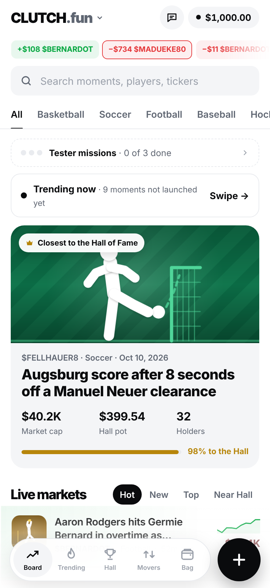
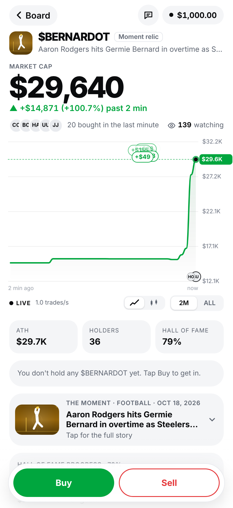

# Clutch prototype

Launch coins on live sports moments. Play-money prototype: every trader except you is a bot.

**Live demo:** https://alagiewon.github.io/clutch-app/ (on iPhone: open in Safari → Share → Add to Home Screen)

 

## Updating the live site
Upload the new files over the old ones and bump `build` in `version.json` (and the matching `var B=` near the top of `index.html`). Phones that already have Clutch open reload to the new build automatically.

## Put it online (pick one, ~2 minutes)
- **Netlify Drop:** go to app.netlify.com/drop and drag this whole folder onto the page. You get a link immediately.
- **Vercel:** `npx vercel` inside this folder, accept the defaults.
- **GitHub Pages:** push the folder to a repo, then Settings → Pages → deploy from the main branch.

Keep all files together: the page loads `coins.json` (the board) and `trending.json` (the Trending tab) from the same folder.

## Put it on your phone
- **iPhone:** open the link in Safari → Share → Add to Home Screen. It opens full screen with the Clutch icon.
- **Android:** open the link in Chrome → ⋮ → Add to Home screen (or Install app).

## What works where
| Feature | Shared Claude link | Self-hosted copy |
|---|---|---|
| The game, charts, Hall pot, dumps | yes | yes |
| Intro, missions | yes | yes (saved on the device) |
| Tester leaderboard | yes | no |
| Feedback + answers reaching you | yes (inbox in Demo settings) | only if you set `FEEDBACK_URL` |

To collect feedback from a self-hosted copy, make a free form (Tally or Google Forms), then in `index.html`
search for `const FEEDBACK_URL=""` and paste the form link between the quotes.

## Keeping coins fresh
Replace `coins.json` and `trending.json` with the latest versions from the Claude artifact (the daily routine updates them there).
Coins older than about two weeks drop off the board automatically unless a player holds them.

Notes: vibration works on Android only (iPhone browsers don't allow it). Sound starts after the first tap.
